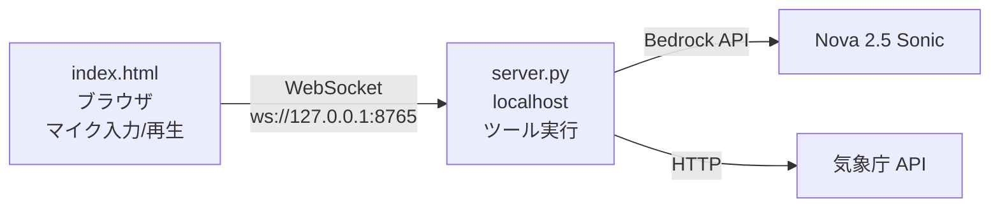

このリポジトリは AWS Deep Cuts の、Amazon Nova 2.5 Sonic に関するハンズオンコンテンツです。

<!-- TODO: 記事公開後にリンクを追加 -->
<!-- Amazon Nova 2.5 Sonicの解説記事(AWS Builder Center)は[こちら]() -->

解説記事の原稿は [article/amazon-nova-2-5-sonic.md](./article/amazon-nova-2-5-sonic.md) にあります。

> **Note**: このハンズオンは 2026 年 10 月に GA となった **Amazon Nova 2.5 Sonic**（モデル ID: `amazon.nova-2-5-sonic`）を使用します。

# AWS Deep Cutsとは
AWS Deep Cutsは、AWS の最新のサービスやニッチな機能、または高度にアカデミックな知識を要求するサービスなど、多くの人が知らない 『隠れた名曲 = **Deep Cuts**』 を深くまで掘り下げる技術シリーズです。

このようなサービスはWeb情報も少なく、初学者は気軽にキャッチアップできないのが実情です。

そこで AWS Deep Cuts シリーズでは、**前提知識も含めた分かりやすいサービス解説** と **手順通りに進めれば誰でも再現できるハンズオン** を提供します！

## ハンズオンのゴール

このハンズオンでは、ローカル PC 上に Nova 2.5 Sonic のプレイグラウンドを構築し、**プロンプトを自由に書き換えながら** 以下の 8 つの観点を確認します。

1. 通常のプロンプトでは AI が自分から話しかけてこないこと
2. クロスモーダル入力 (Model-start-first) で AI から先に話しかけてくれること
3. 話者 (voiceId) を変更できること
4. 言語を変更できること（ポリグロットボイス）
5. ターンテイキングと割り込み (barge-in) が自然に動作すること
6. 話し方の抑揚・テンションが AI の応答スタイルにも影響すること
7. Tool use で外部情報（今日の天気）を取得できること
8. 発話スピード制御の制約を理解すること

## ハンズオン手順

以降の手順は、ローカル PC（Windows / macOS / Linux）で実施してください。

### 前提条件

- **Python 3.12 以上**（Nova 2.5 Sonic の双方向ストリーミングに使う `aws-sdk-bedrock-runtime` が 3.12 以上必須のため）
- AWS の認証情報が設定済みであること（下表のいずれでも可）
- IAM 権限 `bedrock:InvokeModel`（`amazon.nova-2-5-sonic` に対して）
- マイク付きの PC + Chrome / Edge ブラウザ

| 認証方式 | 事前に実行するコマンド |
| -- | -- |
| IAM Identity Center (AWS SSO) | `aws configure sso` → `aws sso login --profile <プロファイル名>` |
| `aws login`（コンソールの認証情報でサインイン） | `aws login` |
| IAM ユーザーのアクセスキー | `aws configure` |
| AssumeRole プロファイル / `credential_process` | `~/.aws/config` に設定 |
| 環境変数（Identity Center ポータルの「アクセスキー」をコピーした場合など） | `AWS_ACCESS_KEY_ID` などを設定 |

`default` 以外のプロファイルを使う場合は、実行前に環境変数 `AWS_PROFILE` を設定してください。

```bash
# macOS / Linux
export AWS_PROFILE=<プロファイル名>

# Windows (PowerShell)
$env:AWS_PROFILE="<プロファイル名>"
```

<details>
<summary>最小権限の IAM ポリシー例（Identity Center の場合は許可セットのインラインポリシーに設定）</summary>

```json
{
  "Version": "2012-10-17",
  "Statement": [
    {
      "Effect": "Allow",
      "Action": "bedrock:InvokeModel",
      "Resource": "arn:aws:bedrock:*::foundation-model/amazon.nova-2-5-sonic"
    }
  ]
}
```

`InvokeModelWithBidirectionalStream` API は `bedrock:InvokeModel` アクションで認可されます（[API リファレンス](https://docs.aws.amazon.com/bedrock/latest/APIReference/API_runtime_InvokeModelWithBidirectionalStream.html)）。
</details>

### １．セットアップ + サーバー起動

```bash
git clone https://github.com/AWS-Deep-Cuts/amazon-nova-2-5-sonic.git
cd amazon-nova-2-5-sonic/hands-on
python setup.py
```

> **Note**: macOS / Linux の場合は `python3 setup.py`（Python 3.12 未満が既定の場合は `python3.12 setup.py`）、Windows で複数の Python がある場合は `py -3.12 setup.py` を使用してください。

> **Note**: `externally-managed-environment` でパッケージのインストールに失敗する場合は、仮想環境を作成してから実行してください。
> ```bash
> python3.12 -m venv .venv
> source .venv/bin/activate      # Windows: .venv\Scripts\activate
> python setup.py
> ```

setup.py は以下を順に確認し、問題があれば **原因と対処方法** を表示して停止します。

1. Python のバージョン
2. 依存パッケージ（`requirements.txt`）の確認・インストール
3. AWS 認証（どの認証方式・どの IAM ロールで認証されたかを表示）
4. Nova 2.5 Sonic の呼び出し確認（実際にストリームを開き、権限・リージョンを検証）
5. Nova 2.5 Sonic からのあいさつ（AI から「Welcome to AWS Deep Cuts!」と一言話して終わります）
6. WebSocket 中継サーバーの起動

> **Note**: あいさつ音声は `hands-on/output/welcome.wav` に保存され、OS 標準のプレイヤー（macOS: `afplay` / Windows: PowerShell / Linux: `paplay`・`aplay` など）で再生されます。自動再生できない環境ではファイルのパスが表示されます。あいさつが不要な場合は `python setup.py --no-welcome` で実行してください。
>
> このあいさつは、ユーザーが何も話さなくても AI から話し始める **Model-start-first** パターン（観点 2）の応用です。中身は [welcome.py](./hands-on/welcome.py) を参照してください。

以下の表示が出れば準備完了です。

```
  WebSocket: ws://127.0.0.1:8765
  Security:  127.0.0.1 only (外部アクセス不可)

  index.html をブラウザで開いてください。
```

> **セキュリティ**: サーバーは `127.0.0.1` にのみバインドされます。外部からアクセスすることはできません。

### ２．ブラウザでプレイグラウンドを開く

`hands-on/index.html` をブラウザで直接開きます（ダブルクリックまたは以下）。

```bash
# macOS
open index.html

# Windows
start index.html

# Linux
xdg-open index.html
```

### ３．8 つの観点を確認する

以下の各観点について、プロンプトや設定を変更しながら動作を確認してください。各観点の冒頭に「何をして、どうなることを確かめるのか」をまとめています。まずそこを読んでから手順に進むと、何に注目すればよいかが分かりやすくなります。

---

#### 観点 1: 通常プロンプトでは AI が自分から話しかけない

> **この観点で確かめること**
> - **やること**: デフォルトのシステムプロンプトのまま Start し、**何も話さずに** 待ちます。
> - **期待する結果**: AI は何も話さず、沈黙したままになります。
> - **ここから分かること**: Nova 2.5 Sonic は、ユーザーからの入力があって初めて応答を生成します。システムプロンプトを渡すだけでは会話は始まりません。これが観点 2 の前提になります。

**確認手順:**
1. System Prompt をデフォルトのままにする:
   ```
   You are a friendly English conversation partner. Keep responses short (1-2 sentences). Respond in the same language as the user.
   ```
2. 「Start」を押してマイクを開始する
3. **何も話さずに 5〜10 秒待つ**
4. AI は沈黙したままであることを確認する

**理由**: Nova 2.5 Sonic は speech-to-speech モデルであり、ユーザーの音声入力を検知するまで応答を生成しません。

---

#### 観点 2: Model-start-first で AI から先に話しかけさせる

> **この観点で確かめること**
> - **やること**: 「最初に挨拶して」と書いたシステムプロンプトで Start し、テキスト入力バーから短い文字（`Start`）を 1 回だけ送ります。マイクには何も話しません。
> - **期待する結果**: テキストを送った直後に、AI がシステムプロンプトで指定した挨拶を **音声で** 話し始めます。テキストを送るまでは、観点 1 と同じく沈黙したままです。
> - **ここから分かること**: AI から話しかけるアプリ（英会話の講師役、受付の案内など）を作るには、「何を話すか」をシステムプロンプトで決め、「いつ話し始めるか」をクライアントからのテキスト送信で合図する必要があります。

**確認手順:**
1. System Prompt を以下に書き換える:
   ```
   You are a friendly English tutor. As soon as the conversation starts, greet the student by saying "Hello! Welcome to today's English lesson. How are you feeling today?" Do not wait for the user to speak first.
   ```
2. 「Start」を押す
3. 画面下部のテキスト入力バーに `Start` と入力して Enter（Send）を押す
4. **何も話さずに待つ** — AI が System Prompt で指定した挨拶を音声で開始することを確認する

**仕組み**: Nova 2.5 Sonic は何らかのユーザー入力がなければ応答を生成しません。音声の代わりに**テキスト入力バーから短いメッセージを送信**することで、モデルに「今話し始めてよい」と合図できます。発話の内容を決めるのはあくまで System Prompt であり、テキスト入力は発火トリガーに過ぎません。

これが [Cross-modal input](https://docs.aws.amazon.com/nova/latest/nova2-userguide/sonic-cross-modal.html) を利用した "Model-start-first" パターンです。

---

#### 観点 3: 話者 (voiceId) の変更

> **この観点で確かめること**
> - **やること**: 設定の `voiceId` だけを `matthew` → `tiffany` → `amy` と変えながら、毎回同じことを話しかけます。
> - **期待する結果**: 応答の内容は同じようなものでも、声の性別・声質・アクセント（アメリカ英語 / イギリス英語）がはっきり変わります。
> - **ここから分かること**: 声はセッション開始時の設定（`promptStart`）で決まり、会話の途中では変えられません。声を変えるには、セッションを開き直す必要があります。

**確認手順:**
1. Settings を開き、Prompt Config の `audioOutputConfiguration.voiceId` を確認する（デフォルト: `"matthew"`）
2. Start → 何か話す → 声を確認 → Stop
3. Prompt Config の `voiceId` を `"tiffany"` に書き換えて Start → 同じことを話す → Stop
4. `voiceId` を `"amy"` に書き換えて Start → 同じことを話す → Stop

```json
{
  "audioOutputConfiguration": {
    "mediaType": "audio/lpcm",
    "sampleRateHertz": 24000,
    "sampleSizeBits": 16,
    "channelCount": 1,
    "voiceId": "tiffany",
    "encoding": "base64",
    "audioType": "SPEECH"
  },
  "textOutputConfiguration": { "mediaType": "text/plain" }
}
```

**確認ポイント**: 同じプロンプト・同じ質問でも、voiceId によって声質・アクセントが明確に変わることを確認してください。

**制約**: voiceId はセッション開始時に決定され、セッション途中で変更できません（1 セッション = 1 voice）。

参考: [Language Support & Voices](https://docs.aws.amazon.com/nova/latest/nova2-userguide/sonic-language-support.html) — 利用可能な voiceId 一覧

---

#### 観点 4: 言語の変更（ポリグロット）

> **この観点で確かめること**
> - **やること**: 声は `matthew` のまま、システムプロンプトで応答する言語をスペイン語 → 日本語と変えて、AI に話し始めてもらいます。
> - **期待する結果**: スペイン語は、同じ声のまま自然に話します。日本語はサポート外のため、英語で答えたり、発音が不安定になったりします。
> - **ここから分かること**: ポリグロットボイス（`matthew` / `tiffany`）なら、声を変えずに複数の言語に対応できます。一方で、日本語のプロダクトにはそのまま使えないという制約も確認できます。

**確認手順 A — サポート言語（スペイン語）:**
1. Prompt Config の `voiceId` が `"matthew"` (ポリグロット) であることを確認する
2. System Prompt を以下に変更:
   ```
   You are a helpful assistant. Always respond in Spanish. Start by saying "¡Hola! ¿Cómo estás?"
   ```
3. Start → テキスト入力バーから `Start` と送信する
4. AI が**スペイン語で** "¡Hola! ¿Cómo estás?"（オラ！コモ エスタス？）と発話することを確認する

**確認手順 B — 非サポート言語（日本語）:**
1. Stop → System Prompt を以下に変更:
   ```
   You are a helpful assistant. Always respond in Japanese. Start by saying "こんにちは！"
   ```
2. Start → テキスト入力バーから `Start` と送信する
3. AI の挙動を確認する — 日本語は公式サポート言語ではないため、英語にフォールバックする、または不安定な発音になることがある

**ポイント**: matthew と tiffany はポリグロットボイスで、voiceId を変えずに 7 言語（英/仏/伊/独/西/葡/ヒンディー）を話せます。日本語・中国語・韓国語などは公式サポート外です。

参考: [Language Support & Voices](https://docs.aws.amazon.com/nova/latest/nova2-userguide/sonic-language-support.html)

---

#### 観点 5: ターンテイキングと割り込み (barge-in)

> **この観点で確かめること**
> - **やること**: (1) 話し終わりを判定する感度 `endpointingSensitivity` を `LOW` と `HIGH` で切り替え、間を空けながら話します。(2) AI が話している最中に、声をかぶせて割り込みます。
> - **期待する結果**: (1) `LOW` では数秒の間を空けても最後まで待ってくれます。`HIGH` では短い間でも AI が話し始めます。(2) 割り込むと AI の声がすぐに止まり、中断前の話を覚えたまま、割り込んだ質問に答えます。
> - **ここから分かること**: 「ユーザーが話し終わったか」の判定と割り込みへの対応は、モデルに組み込まれています。ただし、受信済みの音声の再生を止めるのはアプリ（クライアント）側の仕事です。

**ターンテイキングの確認:**
1. Settings を開き、Session Config の `turnDetectionConfiguration.endpointingSensitivity` を `"LOW"` に書き換えて Start
2. ゆっくり、途中で 2〜3 秒ポーズを入れながら話す（例: "I think... um... maybe... we should..."）
3. AI がポーズ中に割り込まず、発話完了を待つことを確認する
4. Stop → `endpointingSensitivity` を `"HIGH"` に書き換えて同じことを試す
5. AI が短いポーズで即座に応答を始めることを確認する

```json
{
  "inferenceConfiguration": { "maxTokens": 1024, "topP": 0.9, "temperature": 0.7 },
  "turnDetectionConfiguration": { "endpointingSensitivity": "LOW" }
}
```

**barge-in（割り込み）の確認:**
1. `endpointingSensitivity` を `"MEDIUM"` に戻して Start
2. AI に長い応答をさせる — 以下のように話しかける:
   ```
   "Tell me a long story about a cat who goes on an adventure"
   ```
3. **AI が物語を話している途中で**（3〜5秒後）、大きな声で割り込む:
   ```
   "Stop! What was the cat's name?"
   ```
4. 以下の 2 点を確認する:
   - AI が即座に発話を中断すること（音声がぴたりと止まる）
   - AI が中断前の内容を覚えており、猫の名前について回答すること（コンテキスト保持）

**仕組み**: Nova 2.5 Sonic はビルトインの VAD (Voice Activity Detection) でターン検出を行います。barge-in 時は `stopReason: "INTERRUPTED"` をクライアントに送信し、クライアント側で再生中の音声キューを即座にクリアします。コンテキストは保持されるため、中断前の話題について質問できます。

参考: [Barge-in](https://docs.aws.amazon.com/nova/latest/nova2-userguide/sonic-barge-in.html) / [Turn-taking Controllability](https://docs.aws.amazon.com/nova/latest/nova2-userguide/sonic-turn-taking.html)

---

#### 観点 6: 声の抑揚・テンションが応答に影響する

> **この観点で確かめること**
> - **やること**: 同じ質問 "How are you today?" を、普通のトーン・ハイテンション・疲れた小声の 3 通りで話しかけます。
> - **期待する結果**: AI の応答のトーン、エネルギー、テンポが、こちらの話し方に合わせて変わります。
> - **ここから分かること**: 音声をいったん文字起こしする従来の構成（音声認識 → LLM → 音声合成）では失われる「どう話したか」という情報を、Nova 2.5 Sonic は音声のまま受け取って応答に反映しています。

**確認手順:**
1. 同じ質問を**異なるテンション**で話す:
   - 1回目: 落ち着いた普通のトーンで "How are you today?"
   - 2回目: 非常に元気で高いテンションで "HOW ARE YOU TODAY!!"（大きな声で、高いテンションで）
   - 3回目: 疲れた小さな声で "how are you today..."（ぼそぼそと）
2. AI の応答のトーン・スピード・エネルギーが入力に応じて変化することを確認する

**仕組み**: Nova 2.5 Sonic は "Adaptive speech response" 機能を持ち、入力音声の prosody (韻律) に基づいて応答のデリバリーを動的に調整します。これは公式ドキュメントで明記されている機能です。

---

#### 観点 7: Tool use で天気情報を取得する

> **この観点で確かめること**
> - **やること**: Tool use を有効にして、AI に今日の天気を尋ねます。
> - **期待する結果**: ログに `Tool: get_weather(...)` が表示され、AI が気象庁 API から取得した実際の予報を音声で答えます。地域を変えて尋ねると、その地域の予報に変わります。
> - **ここから分かること**: 会話の途中で「いつツールを呼ぶか」「どんな引数で呼ぶか」はモデルが決めます。アプリ側の仕事は、ツールを実行して結果をモデルに返すことだけです。

**確認手順:**
1. Settings を開き、「Tool use を有効にする (天気取得)」チェックボックスをオンにする
2. System Prompt を以下に変更:
   ```
   You are a helpful weather assistant. When the user asks about the weather, use the get_weather tool to fetch real data. Report the results naturally in speech.
   ```
3. Start → 英語で "What's the weather like in Tokyo today?" と話しかける（日本語はサポート外のため、英語で話しかけます）
4. ログに `Tool: get_weather` が表示され、AI が実際の天気情報を音声で報告することを確認する
5. "How about Osaka?" "What about Fukuoka?" など、別の地域も試す

**仕組み**: Nova 2.5 Sonic が `toolUse` イベントを送信 → サーバーが気象庁 API を呼び出し → `toolResult` でモデルに結果を返す → モデルが結果を音声で報告する。

---

#### 観点 8: 発話スピードの制御（制約の確認）

> **この観点で確かめること**
> - **やること**: まずシステムプロンプトで「ゆっくり話して」と指示します。次に、プロンプトは変えずに、自分がとてもゆっくり話しかけます。
> - **期待する結果**: プロンプトで指示しても、話す速さはほとんど変わりません。自分がゆっくり話すと、AI の応答もやや落ち着いたペースになります。
> - **ここから分かること**: 話す速さはパラメータやプロンプトで指定するものではなく、ユーザーの話し方によって誘導されるものです。確実に遅くしたい場合は、アプリ側で再生速度を変えるなどの工夫が必要です（画面右下の Speed スライダー）。

**確認手順:**
1. System Prompt を以下に変更して Start:
   ```
   You are a helpful assistant. Speak very slowly and clearly, as if explaining to a young child. Take your time with each word.
   ```
2. 何か質問する — **AI の発話スピードはほとんど変わらないことを確認する**
3. Stop → 今度は自分が**非常にゆっくり**話しかけてみる（1単語ずつ区切って）
4. AI の応答スピードが入力に合わせてやや遅くなることを確認する

**制約（公式ドキュメントより）**: Nova 2.5 Sonic の発話スピードは**システムプロンプトで直接制御できません**。公式ドキュメントには以下のように明記されています:

> "While you can't control voice parameters directly, you can influence how natural and engaging the spoken interaction feels through the content generated."
>
> — [System prompt authoring guidelines](https://docs.aws.amazon.com/nova/latest/userguide/prompting-speech-speech.html)

発話スピードは、ユーザーの入力音声の韻律（prosody: ペース、抑揚、音量）に**適応的に調整**されます（観点6の Adaptive speech response）。つまり:

| 制御したいこと | 方法 |
| -- | -- |
| AI の応答のスピード | ユーザー自身がゆっくり/早く話す（入力 prosody に適応） |
| AI の応答の長さ | System Prompt で指示（"Keep responses to 1-2 sentences"） |
| AI の言葉遣い・スタイル | System Prompt で指示 |
| AI の声の高さ・速度パラメータ | **制御不可**（voiceId 固有の特性） |

参考: [Voice conversation prompts](https://docs.aws.amazon.com/nova/latest/nova2-userguide/sonic-system-prompts.html) / [Prompting best practices](https://docs.aws.amazon.com/nova/latest/userguide/prompting-speech-best-practices.html)

---

### ４．後片付け

サーバーを Ctrl+C で停止します。

Nova 2.5 Sonic は Bedrock のオンデマンド API のため、AWS リソースの削除は不要です。クローンしたフォルダは不要になったら削除してください。

```bash
cd ../..
rm -rf amazon-nova-2-5-sonic
```

## トラブルシューティング

エラーはターミナル（setup.py / server.py）とブラウザのログの両方に、**原因と対処方法** の形で表示されます。主なものは以下の通りです。

| 表示されるエラー | 主な原因 | 対処 |
| -- | -- | -- |
| Python 3.12 以上が必要です | Python が古い | Python 3.12 以上をインストールして実行 |
| AWS の認証情報が見つかりません | 認証未設定 / プロファイル未指定 | 前提条件の表を参照。`AWS_PROFILE` の設定漏れに注意 |
| IAM Identity Center (SSO) のセッションが切れています | SSO のアクセストークン失効 | `aws sso login --profile <プロファイル名>` |
| 一時的な認証情報の有効期限が切れています | 環境変数に貼った一時キーの失効 | 環境変数を削除してプロファイルを使う、または再取得 |
| IAM の権限が不足しています | `bedrock:InvokeModel` が無い / SCP で拒否 | 許可セット・IAM ポリシーに権限を追加 |
| リージョン ... では利用できません | 非対応リージョン / アカウントでモデルを直接呼び出せない | `AWS_REGION` を `us-east-1` などに変更。対応リージョンでも失敗する場合は `NOVA_SONIC_MODEL_ID=us.amazon.nova-2-5-sonic`（クロスリージョン推論プロファイル）を試す |
| 中継サーバーに接続できません | server.py が起動していない | `python setup.py` を実行したターミナルを確認 |
| マイクの使用が許可されていません | ブラウザ / OS のマイク権限 | ブラウザのサイト設定と OS のプライバシー設定で許可 |
| 1 接続の上限 (8 分) に達したため... | Nova 2.5 Sonic の接続上限 | Start で新しいセッションを開始 |

より詳しいスタックトレースを見たい場合は、環境変数 `DEBUG=1` を付けて起動してください。

## アーキテクチャ



- **セキュリティ**: server.py は `127.0.0.1` にのみバインド。外部ネットワークからアクセスできません。さらに WebSocket の Origin を検証し、`file://` で開いた index.html と localhost 以外（ブラウザで開いている他の Web サイト）からの接続を拒否します。
- **認証**: boto3 と同じ解決順序で AWS の認証情報を取得します（環境変数 → プロファイル（SSO / aws login / AssumeRole / credential_process / アクセスキー）→ コンテナ / インスタンスロール）。ブラウザに認証情報は渡しません。
- **通信**: Nova 2.5 Sonic の双方向ストリーミングは HTTP/2 が必要なため、AWS CRT の HTTP クライアントを使用します。
